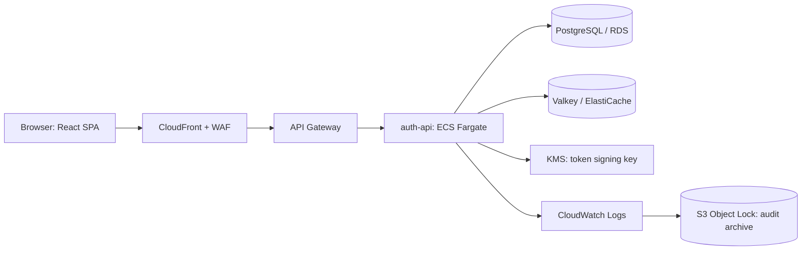

# zero-trust-identity

> A WebAuthn/FIDO2 identity service with short-lived access tokens, rotating refresh tokens and a tamper-evident audit log. No passwords exist anywhere in the system.


**Status:** Phase 0, repository scaffolding. Nothing below the "Run locally" heading works yet; each section is marked when it does.

## Why this exists

Password plus TOTP is vulnerable to real-time proxy phishing. This project builds the alternative end to end: phishing-resistant authentication (WebAuthn with user verification), tokens that expire in minutes, refresh-token reuse detection, and an audit trail you can verify has not been altered. The goal is to understand why identity services are shaped the way they are, and to defend every decision in them.

The full design rationale, alternatives considered and build sequence are in the **[build manual](TODO-link-to-manual)**. Individual decisions are recorded in [`docs/adr/`](docs/adr/).

## Architecture

<!-- TODO: replace with the final diagram (Figure 2 of the build manual) once the design is frozen. -->



Key properties: the signing key never exists in application memory (KMS signs), the application tier is stateless, and the audit path is write-only.

## Run locally in under five minutes

> **TODO (Phase 0 exit):** these commands are the *target*. Confirm each one works from a fresh clone before removing this note. If the five-minute promise breaks, fix the setup, not the promise.

**Option A: Dev Container (supported path)**
1. Open the repo in VS Code and choose **Reopen in Container**.
2. Run `make bootstrap`. This creates `.env` from `.env.example` with obviously fake values.
3. Run `docker compose up -d` (PostgreSQL 16, Valkey 8, LocalStack).
4. Run `npm run dev`.

**Option B: native (fallback)**

Prerequisites: Node 22 (see `.nvmrc`), npm 10, Docker with Compose.

```bash
git clone https://github.com/your-handle/zero-trust-identity.git
cd zero-trust-identity
nvm use                 # reads .nvmrc
npm ci
make bootstrap          # .env from .env.example
docker compose up -d
npm run dev
```

- Web: http://localhost:5173
- API: http://localhost:3000
- WebAuthn needs a secure context. `localhost` qualifies; see the build manual §5.3.2 for the Relying Party ID rules.
- No hardware key? Use the Chrome DevTools **virtual authenticator** (DevTools, then More tools, then WebAuthn).

## Repository layout

```text
apps/api/         Fastify service (domain / application / adapters / http)
apps/web/         React 19 + Vite SPA
packages/contracts/  zod schemas and types shared by api and web
infra/            Terraform modules and per-environment roots
loadtest/         k6 scripts and result snapshots
docs/adr/         Architecture decision records
docs/evidence/    Load-test, EXPLAIN and drill results
.github/          Workflows, PR template, CODEOWNERS
```

## Tech stack

TypeScript (strict) on Node 22 and Fastify, React 19, PostgreSQL 16, Valkey, Terraform, GitHub Actions, AWS (ECS Fargate, RDS, ElastiCache, KMS, API Gateway, CloudFront, S3 Object Lock, Secrets Manager).

## Scope and honesty

Single region, two Fargate tasks, `db.t4g.micro`. Every performance figure in this repo was measured by the author on that setup and is labelled as such. This is built to production *standards* on prototype-*scale* infrastructure.

## Contributing and security

- Conventions, branch naming and the review policy: [CONTRIBUTING.md](CONTRIBUTING.md)
- Reporting a vulnerability: [SECURITY.md](SECURITY.md)

## Licence

[MIT](LICENSE)
